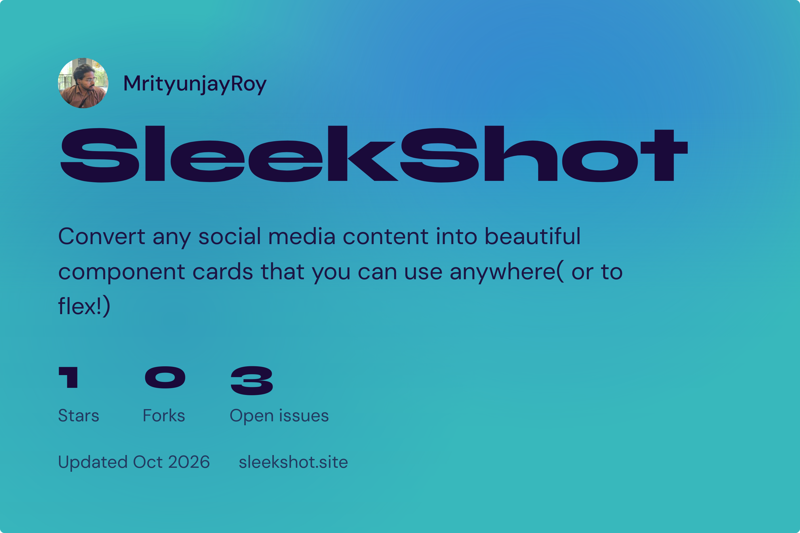
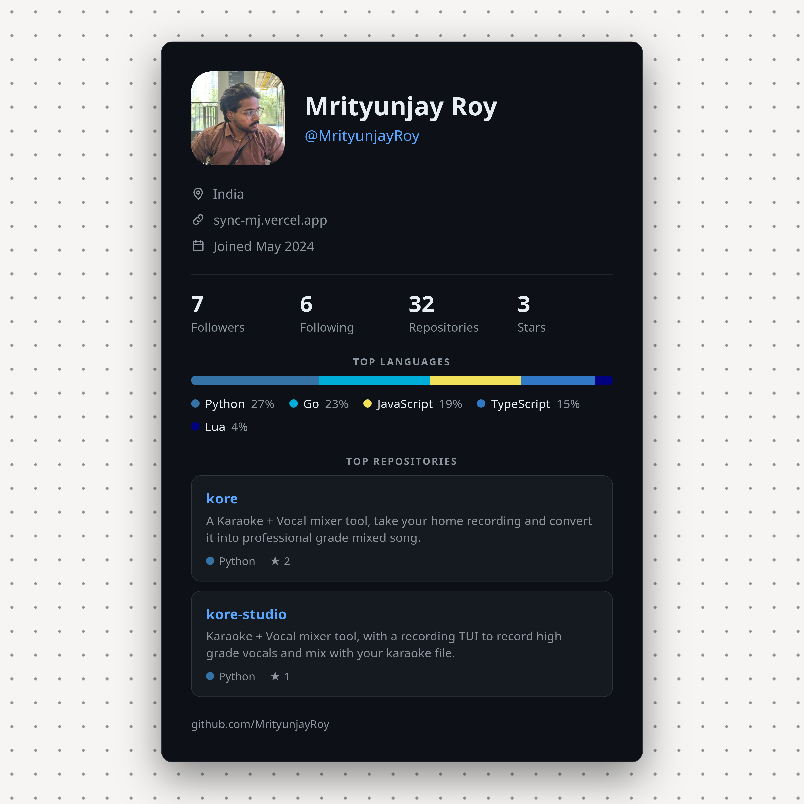

<div align="center">



# SleekShot

Make sleek looking screenshots in one click. No signup or login.

</div>

Turn live data into share-ready PNG cards. Point SleekShot at a YouTube video,
a GitHub profile, or a GitHub repository, tweak the look in a live preview, and
export the result as a high-resolution image (or copy it straight to the
clipboard).

Everything is rendered in the browser and captured with
[`html-to-image`](https://github.com/bubkoo/html-to-image), so what you see in
the preview is exactly what gets downloaded. Card style settings are remembered
in `localStorage` between visits. The app chrome uses a calm, monotonic neutral
theme (light/dark) — card content keeps its own full-color presets.

## Examples

Generated with the GitHub profile builder (`/github`):




## Features

- **Live preview** that scales to fit while exporting at full size.
- **Data pulled from the source** – video stats from the YouTube Data API,
  profile/repo details from the GitHub REST API.
- **Backgrounds** – solid, gradient, image upload, blurred thumbnail, or
  automatic colors sampled from the avatar/thumbnail, plus pattern overlays.
- **Layout controls** – canvas size presets (link preview, square, portrait,
  story, wide, custom), padding, corner radius, borders, shadows and accent
  stripes.
- **Content controls** – edit every field (title, bio, stats, repo topics…)
  before exporting.
- **Typography** – bundled fonts (DM Sans, Geist, Instrument Serif, Space Mono,
  Syne), size, weight and pairing controls.
- **Export** – download a PNG, copy to clipboard, export every preset size, or
  batch-export multiple repos at once, at 1x/2x/3x resolution.

## Run it locally

```bash
git clone git@github.com:MrityunjayRoy/SleekShot.git
cd SleekShot
npm i
npm run dev      # start the Next.js dev server
```
